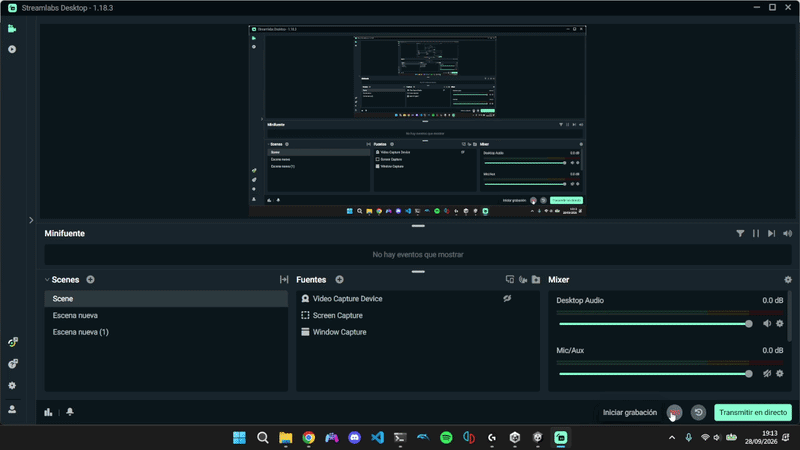
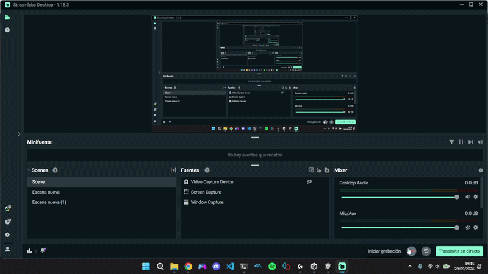
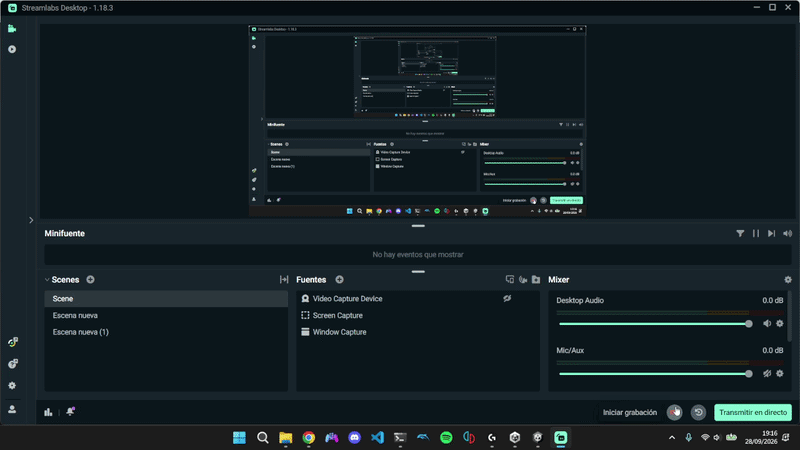
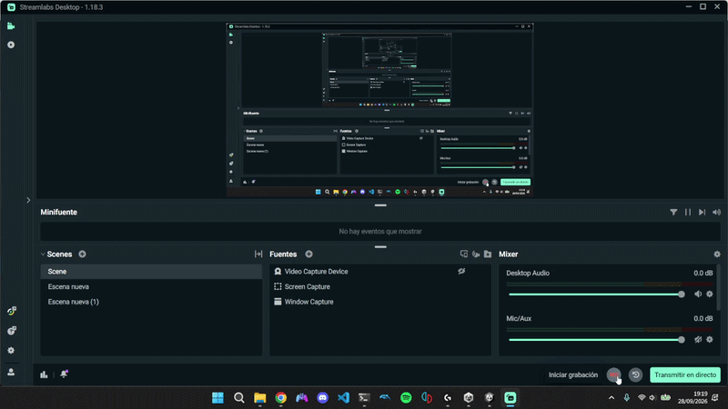

# Práctica 1 · Scripts: Movimiento (Unity)

Interfaces Inteligentes — Pablo García de los Reyes

Este repositorio contiene los scripts C# de la práctica y este informe. Cada ejercicio tiene su propio script en [`Scripts/`](Scripts/) y su prueba de ejecución (GIF animado) en [`gifs/`](gifs/).

## Configuración de la escena

- Objetos: un **cubo**, una **esfera** y un **cilindro** sobre un plano.
- Etiquetas (Tags) creadas: `cubo`, `cilindro` y `blue_sphere` (esfera).
- Se usa el sistema de entrada antiguo: *Edit → Project Settings → Player → Other Settings → Active Input Handling = Input Manager (Old)* (o *Both*).

| Script | Objeto |
|---|---|
| `Ej01_CambioColor` | Cubo |
| `Ej02_OperacionesVectores` | Esfera |
| `Ej03_PosicionEsfera` | Esfera |
| `Ej04_DistanciaObjetos` | Esfera |

---

## Ejercicio 1 — Cambio de color cada N frames

El script inicializa un array de 3 `float` con `Random.Range(0.0f, 1.0f)` y lo aplica como `Color` al material del objeto. En `Update` se cuentan frames; al llegar a `framesEspera` (público, 120 por defecto) se elige una posición aleatoria con `Random.Range(0, 3)` (con enteros el máximo es exclusivo), se le da un nuevo valor y se reasigna el color.

## Ejercicio 2 — Operaciones con vectores

Dos `Vector3` públicos (`vectorA`, `vectorB`) editables en el inspector. Se calculan:

- Magnitud: `vector.magnitude`
- Ángulo: `Vector3.Angle(a, b)`
- Distancia: `Vector3.Distance(a, b)`
- Vector más alto: comparación de la componente `y`.

Los resultados se muestran en consola (`Start`) y en campos públicos del inspector, que se recalculan en `OnValidate` cada vez que se modifica un vector.

## Ejercicio 3 — Posición de la esfera en pantalla

Se obtiene la posición con `transform.position` (equivalente a `GetComponent<Transform>().position`) y se dibuja en pantalla con `OnGUI` / `GUI.Label`. También se muestra en consola y en el inspector.

## Ejercicio 4 — Distancia al cubo y al cilindro

Desde la esfera se localizan el cubo y el cilindro con `GameObject.FindWithTag(...)`, se accede a su `Transform` y se calcula `Vector3.Distance` entre las posiciones. Se muestran las distancias esfera–cubo, esfera–cilindro y cubo–cilindro.

