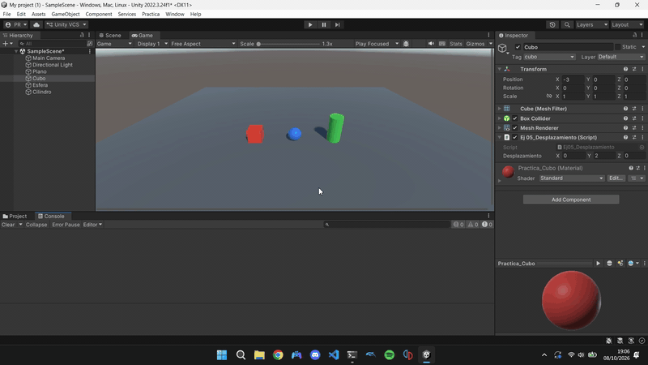
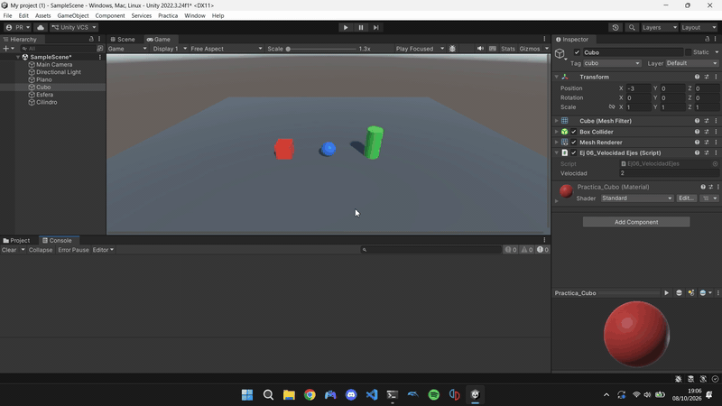
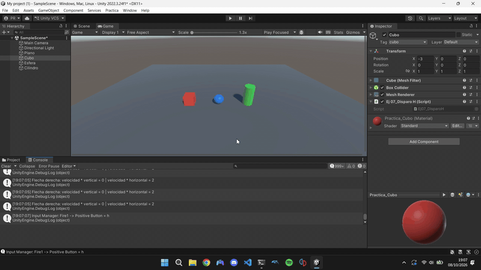
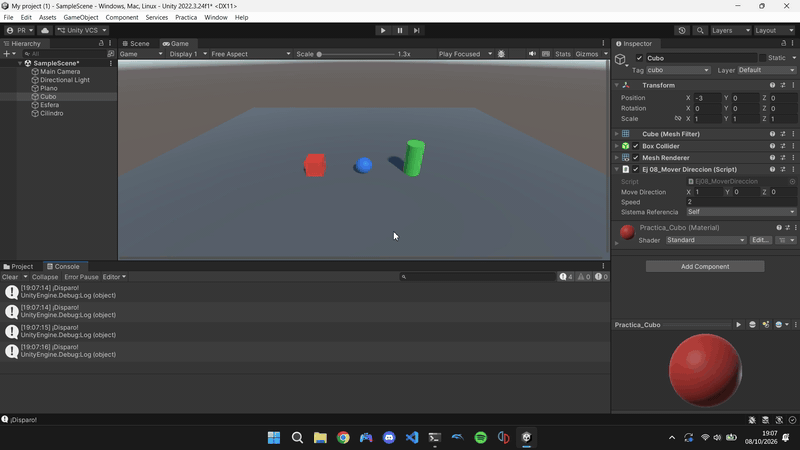
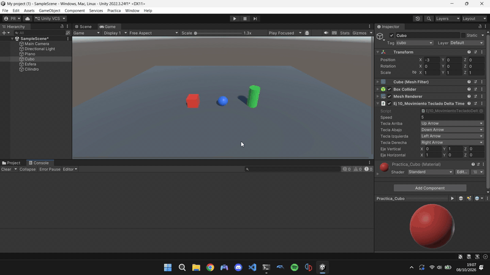
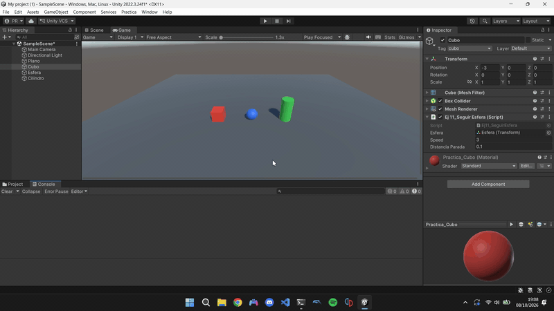
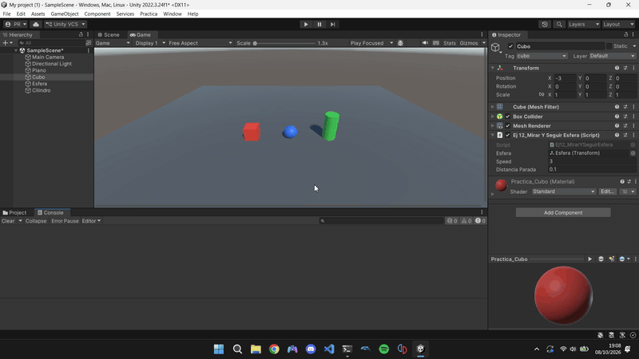

# Práctica 1 · Scripts: Movimiento (Unity)

Interfaces Inteligentes — Pablo García de los Reyes

Este repositorio contiene los scripts C# de la práctica y este informe. Cada ejercicio tiene su propio script en [`Scripts/`](Scripts/) y su prueba de ejecución (GIF animado) en [`gifs/`](gifs/).

## Configuración de la escena

- Objetos: un **cubo**, una **esfera** y un **cilindro** sobre un plano.
- Etiquetas (Tags) creadas: `cubo`, `cilindro` y `blue_sphere` (esfera).
- Se usa el sistema de entrada antiguo: *Edit → Project Settings → Player → Other Settings → Active Input Handling = Input Manager (Old)* (o *Both*).

| Script | Objeto |
|---|---|
| `Ej01_CambioColor` | Cubo |
| `Ej02_OperacionesVectores` | Esfera |
| `Ej03_PosicionEsfera` | Esfera |
| `Ej04_DistanciaObjetos` | Esfera |
| `Ej05_Desplazamiento` | Cubo, esfera y cilindro |
| `Ej06_VelocidadEjes` | Cubo |
| `Ej07_DisparoH` | Cubo |
| `Ej08_MoverDireccion` | Cubo |
| `Ej09_MovimientoTeclado` | Cubo (flechas) y esfera (WASD) |
| `Ej10_MovimientoTecladoDeltaTime` | Cubo (flechas) y esfera (WASD) |
| `Ej11_SeguirEsfera` | Cubo |
| `Ej12_MirarYSeguirEsfera` | Cubo |
| `Ej13_GiroYAvance` | Cubo |

---

## Ejercicio 1 — Cambio de color cada N frames

El script inicializa un array de 3 `float` con `Random.Range(0.0f, 1.0f)` y lo aplica como `Color` al material del objeto. En `Update` se cuentan frames; al llegar a `framesEspera` (público, 120 por defecto) se elige una posición aleatoria con `Random.Range(0, 3)` (con enteros el máximo es exclusivo), se le da un nuevo valor y se reasigna el color.

## Ejercicio 2 — Operaciones con vectores

Dos `Vector3` públicos (`vectorA`, `vectorB`) editables en el inspector. Se calculan:

- Magnitud: `vector.magnitude`
- Ángulo: `Vector3.Angle(a, b)`
- Distancia: `Vector3.Distance(a, b)`
- Vector más alto: comparación de la componente `y`.

Los resultados se muestran en consola (`Start`) y en campos públicos del inspector, que se recalculan en `OnValidate` cada vez que se modifica un vector.

## Ejercicio 3 — Posición de la esfera en pantalla

Se obtiene la posición con `transform.position` (equivalente a `GetComponent<Transform>().position`) y se dibuja en pantalla con `OnGUI` / `GUI.Label`. También se muestra en consola y en el inspector.

## Ejercicio 4 — Distancia al cubo y al cilindro

Desde la esfera se localizan el cubo y el cilindro con `GameObject.FindWithTag(...)`, se accede a su `Transform` y se calcula `Vector3.Distance` entre las posiciones. Se muestran las distancias esfera–cubo, esfera–cilindro y cubo–cilindro.

## Ejercicio 5 — Desplazamiento con la barra espaciadora

Cada uno de los tres objetos tiene el script con un `Vector3` público `desplazamiento` (deltax, deltay, deltaz). En `Start` se guarda la posición original y, cuando `Input.GetAxis("Jump") > 0` (el eje `Jump` está asociado a la barra espaciadora), el objeto se coloca en `posicionOriginal + desplazamiento`. Al partir siempre de la posición original, mantener pulsada la tecla no acumula el desplazamiento.

## Ejercicio 6 — Velocidad por el valor de los ejes

Campo público `velocidad`. Con `Input.GetKey(KeyCode.UpArrow / DownArrow / LeftArrow / RightArrow)` se detecta qué flecha está pulsada y se muestra en consola `velocidad * Input.GetAxis("Vertical")` y `velocidad * Input.GetAxis("Horizontal")`. El mensaje empieza por el nombre de la flecha. Como `GetAxis` está suavizado, el valor crece progresivamente hasta ±1 mientras se mantiene la tecla.

## Ejercicio 7 — Tecla H mapeada al disparo

En *Edit → Project Settings → Input Manager → Axes → Fire1* se cambia *Positive Button* a `h`. El script solo comprueba `Input.GetButtonDown("Fire1")` y escribe `¡Disparo!` en consola, de modo que el mapeo queda en el Input Manager y no en el código.

## Ejercicio 8 — Traslación según `moveDirection` y `speed`

En cada `Update` se llama a `transform.Translate(moveDirection.x * speed, moveDirection.y * speed, moveDirection.z * speed, sistemaReferencia)`. No se multiplica por `Time.deltaTime`, así que `speed` son unidades **por frame** y el cubo se mueve muy rápido (y a distinta velocidad según los FPS).

- **a. Duplicar las coordenadas de la dirección:** el cubo sigue la misma trayectoria pero al doble de velocidad. El vector no está normalizado, por lo que su magnitud también cuenta como velocidad.
- **b. Duplicar la velocidad manteniendo la dirección:** mismo efecto que en (a): el desplazamiento por frame es `moveDirection * speed`, y da igual cuál de los dos factores se duplique.
- **c. Velocidad menor que 1:** en cada frame se recorre solo una fracción de `moveDirection`, por lo que el cubo avanza más despacio (con 0 se queda quieto).
- **d. Cubo con y > 0:** el movimiento es idéntico. `Translate` es un desplazamiento relativo a la posición actual, así que la posición inicial solo desplaza la trayectoria: el cubo se mueve a la altura a la que empieza, flotando sobre el plano.
- **e. Sistema local frente a mundial:** sin rotación, `Space.Self` y `Space.World` coinciden. Si el cubo está rotado, con `Space.Self` se mueve a lo largo de sus propios ejes (girados) y con `Space.World` a lo largo de los ejes de la escena, independientemente de su orientación.

## Ejercicio 9 — Movimiento con el teclado

El mismo script sirve para el cubo y la esfera: las teclas son campos `KeyCode` públicos (flechas por defecto; en la esfera se cambian a W-S y A-D en el inspector). El par arriba/abajo desplaza en el eje vertical y el par izquierda/derecha en el horizontal, con `transform.Translate(movimiento * speed, Space.World)`.

## Ejercicio 10 — Movimiento proporcional al tiempo

Igual que el 9, pero el desplazamiento se multiplica por `Time.deltaTime`. Así `speed` pasa a ser unidades por segundo y el movimiento no depende de los FPS.

## Ejercicio 11 — El cubo va hacia la esfera

La dirección es `esfera.position - transform.position` con la componente `y` a 0 para que el cubo no cambie de altura. Se usa `direccion.normalized` para que el avance sea `speed * Time.deltaTime` esté lejos o cerca la esfera. El cubo se detiene al llegar (`distanciaParada`) para que no vibre sobre ella.

## Ejercicio 12 — El cubo avanza mirando a la esfera

Con `transform.LookAt(objetivo)` el eje Z positivo del cubo apunta a la esfera (el objetivo se toma a la altura del cubo para que no se incline) y se avanza con `transform.Translate(transform.forward * speed * Time.deltaTime, Space.World)`. Hay que indicar `Space.World` porque `transform.forward` ya está en coordenadas del mundo. La esfera se mueve con W-A-S-D y `Debug.DrawRay` dibuja la dirección hacia delante.

## Ejercicio 13 — Giro con el eje Horizontal y avance hacia delante

`Input.GetAxis("Horizontal")` gira el objeto sobre su eje Y (`transform.Rotate`) a `velocidadGiro` grados por segundo, y el objeto avanza siempre según `transform.forward` (la dirección hacia delante del propio objeto, no `Vector3.forward`). `Debug.DrawRay` muestra esa dirección.

